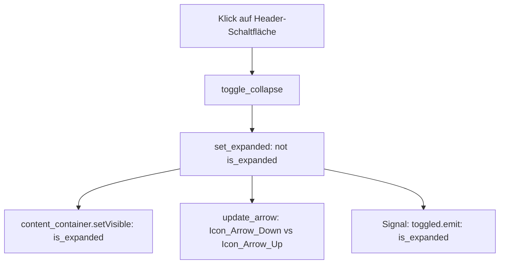

# Dokumentation: LOH_Control_CollapsibleSection

Diese Dokumentation beschreibt die universelle Sci-Fi-Klappsektions-Steuerung [Structure/LOH_Control_CollapsibleSection.py](file:///d:/Starfield_LOH/Structure/LOH_Control_CollapsibleSection.py) im Projekt **Starfield Load Order Helper (LOH)**.

---

## 1. Zweck & Motivation

### 1.1 Technische Problemstellung
In komplexen Werkzeug- und Analysefenstern (wie dem Statistik-Fenster [Window_Mod_Statistics.py](file:///d:/Starfield_LOH/Structure/GUI/Window_Mod_Statistics.py)) existieren zahlreiche inhaltliche Teilbereiche (z. B. Mod-Vergleich, Kategorisierung, Klassifikation, Inhalte und Konflikte).
* **Übersichtlichkeit wahren:** Werden alle Abschnitte permanent voll eingeblendet, verliert der Anwender den Überblick und muss lange vertikal scrollen.
* **Fokussiertes Arbeiten:** Der Anwender muss nicht benötigte Abschnitte mit einem Klick einklappen und bei Bedarf wieder öffnen können.
* **Konsistentes Design:** Alle auf- und zuklappbaren Bereiche müssen der Starfield-Sci-Fi-Formensprache (dunkler Hintergrund `#1e1e1e`, Starfield-Blau `#304C7A`, Akzent-Gold `#D7A64B` und konsistente Pfeil-Icons) folgen.

### 1.2 Die Lösung: `LOH_Control_CollapsibleSection`
`LOH_Control_CollapsibleSection` ist ein autarkes, wiederverwendbares Steuerelement:
1. **Integrierter Header:** Enthält einen responsiven Klick-Button mit Status-Pfeil (`Icon_Arrow_Down.svg` / `Icon_Arrow_Up.svg`), Sektionstitel und dezenten Sci-Fi-Hover-Effekten.
2. **Gekapselter Inhalts-Container:** Beliebige `QWidget`-Instanzen können initial oder dynamisch per `set_content()` eingebettet werden.
3. **Zustandssignal (`toggled`):** Informiert das übergeordnete Fenster per Qt-Signal (`bool`) über den Ein-/Ausklappzustand zur dynamischen Layoutanpassung.
4. **Flackerfreie Umschaltung:** Nutzt Standard-Qt-Sichtbarkeitsregeln (`setVisible`) und automatische Größenanpassungen (`QSizePolicy.Policy.Maximum`), um Sprünge im übergeordneten Layout zu vermeiden.

---

## 2. Architektur & Interaktionsfluss



---

## 3. API-Referenz

### 3.1 Konstruktor
```python
LOH_Control_CollapsibleSection(
    title: str,
    content_widget: QWidget = None,
    parent: QWidget = None,
    is_expanded: bool = True
)
```

| Parameter | Typ | Standard | Beschreibung |
| :--- | :--- | :--- | :--- |
| `title` | `str` | *Pflicht* | Beschriftungstext im Header der Klappsektion. |
| `content_widget` | `QWidget` | `None` | Optionales Inhalts-Widget, das direkt im ausklappbaren Bereich platziert wird. |
| `parent` | `QWidget` | `None` | Übergeordnetes Eltern-Widget. |
| `is_expanded` | `bool` | `True` | Initialer Zustand (`True` = ausgeklappt, `False` = eingeklappt). |

### 3.2 Methoden

| Methode | Parameter | Rückgabe | Beschreibung |
| :--- | :--- | :--- | :--- |
| `set_content(widget)` | `widget: QWidget` | `None` | Ersetzt das aktuelle Inhalts-Widget und entsorgt das vorherige Widget sicher. |
| `toggle_collapse()` | keine | `None` | Schaltet zwischen ausgeklapptem und eingeklapptem Zustand um. |
| `set_expanded(expanded)` | `expanded: bool` | `None` | Setzt den Klappzustand explizit, aktualisiert den Pfeil und emittiert `toggled`. |
| `update_arrow()` | keine | `None` | Lädt das passende Pfeil-Icon (`Icon_Arrow_Down.svg` bei geöffnet, `Icon_Arrow_Up.svg` bei geschlossen). |

### 3.3 Signale

| Signal | Parameter | Beschreibung |
| :--- | :--- | :--- |
| `toggled` | `bool` | Wird ausgelöst, sobald sich der Klappzustand ändert (`True` = geöffnet, `False` = geschlossen). |

---

## 4. Anwendungsbeispiel

```python
from PySide6.QtWidgets import QLabel, QVBoxLayout, QWidget
from Structure.Controls.LOH_Control_CollapsibleSection import LOH_Control_CollapsibleSection

# Inhalts-Widget vorbereiten
content = QWidget()
layout = QVBoxLayout(content)
layout.addWidget(QLabel("Detaildaten zur Modifikation..."))

# Klappsektion erzeugen
sec = LOH_Control_CollapsibleSection(
    title="Mod-Details",
    content_widget=content,
    is_expanded=False
)

# Optional auf Zustand reagieren
sec.toggled.connect(lambda expanded: print(f"Sektion geöffnet: {expanded}"))
```
