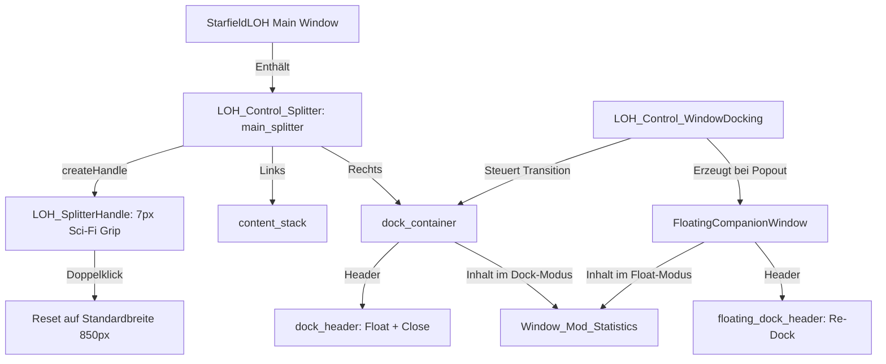

# Dokumentation: LOH_Control_WindowDocking

Diese Dokumentation beschreibt die universelle Begleitpanel- und Docking-Steuerung [Structure/Controls/LOH_Control_WindowDocking.py](file:///d:/Starfield_LOH/Structure/Controls/LOH_Control_WindowDocking.py) im Projekt **Starfield Load Order Helper (LOH)** nach dem Industrie-Standard (VS Code / Blender Pattern).

---

## 1. Zweck & Architektur-Entscheidung

### 1.1 Verworfene Ansätze
* **Qt QDockWidget:** Führte unter Windows zu `Qt.Tool`-Fenstern mit blockiertem Maximieren, winzigen Icons und verzerrtem Hauptfenster-Layout.
* **Getrennte OS-Fenster mit Live-Kanten-Kopplung:** Führte unter Windows reproduzierbar zu Ghosting-Artefakten (durch die modale `WM_SIZING`-Schleife von Windows) und verdeckten Resize-Grips an der Nahtstelle.

### 1.2 Die Lösung: Splitter-Panel + Floating-Window (Konzept A)
`LOH_Control_WindowDocking` vereint das Beste aus zwei Welten:
1. **Angedockter Zustand (LOH_Control_Splitter):**
   - Das Statistik-Widget sitzt eingebettet im maßgeschneiderten `LOH_Control_Splitter` (`main_splitter`) des Hauptfensters rechts neben `content_stack`.
   - **Sci-Fi Grip-Handle (7 px):** Feine Führungslinien und 5 horizontale Grip-Segmente in Starfield-Gold (`#D7A64B`, Ruhezustand `#304C7A`), die bei Hover und Drag dynamisch aufleuchten.
   - **Ergonomie & Doppelklick-Reset:** Cursor `Qt.CursorShape.SplitHCursor` ($\leftrightarrow$). Ein Doppelklick auf den Splittergriff setzt die Breite des Panels automatisch wieder auf den Idealwert (850 px) zurück.
   - **Header-Leiste:** Subfensterleiste mit dezentem Titel `"Docking: Mod-Analyse & Statistiken"` (`{{ TEXT_ON_DARK_MUTED }}`, bold, 14 px), Popout-Button (`btn_dock_float`, Icon `Icon_Undock.svg`) und Schließen-Button (`btn_dock_close`).
2. **Abgedockter Zustand (FloatingCompanionWindow):**
   - Auf Klick auf den Popout-Button löst sich das Statistik-Widget in ein eigenständiges Windows-Top-Level-Fenster (`FloatingCompanionWindow`).
   - Volle OS-Integration: Echtes Maximieren/Vollbild, Minimieren, Windows-11 DWM-Titelleiste (Dark Mode), nativer Taskleisten-Eintrag und Multi-Monitor-Freiheit.
   - Re-Dock-Button im Header (`btn_floating_redock`, Icon `Icon_Dock.svg`), der das Panel direkt wieder in den Splitter des Hauptfensters einhängt.
   - **Design-Konsistenz:** Identische Subfensterleiste wie im Docking (`"Docking: Mod-Analyse & Statistiken"`), saubere Margins und feste Mindestbreite von 850 px.
3. **Automatisches Synchronisieren & Layout-Schutz (Duale Mindestbreiten & dynamische Erweiterung):**
   - **Duale Mindestbreiten:** Im ungedockten/schwebenden Zustand gilt für das Hauptfenster eine Mindestbreite von **1300 px** (`MIN_MAIN_WIDTH`). Im angedockten Zustand greift die Schutzgrenze von **1730 px** (`MIN_DOCKED_TOTAL_WIDTH`), damit Hauptinhalt (mind. 980 px) und Dock (mind. 750 px) niemals gequetscht werden.
   - **Dynamische vs. Statische Erweiterung (`Dynamic_Dock_Expand`):** 
     - *Statisch (`False`, Standard):* Dock öffnet sicher nach innen in das bestehende Fenster unter Wahrung der 1730 px Mindestbreite.
     - *Dynamisch (`True`):* 3-stufige Platzprüfung nach rechts via `_calculate_dock_geometry()`. Stufe 1 expandiert um Wunschbreite, Stufe 2 bis an den Bildschirmrand, Stufe 3 sichert 750 px Mindestdockbreite und kompensiert Fehlbeträge durch Reduzierung des Hauptbereichs nach innen (mind. 1730 px Gesamtbreite).
   - **Intelligente Rückstellung (`_calculate_undocked_width`):** Beim Andocken merkt sich der Manager sowohl die vorherige Fensterbreite (`_pre_dock_width`) als auch die neue Gesamtfensterbreite (`_dock_open_total_width`). Beim Einklappen/Abdocken bleibt der aktuell sichtbare Hauptbereich ($\text{current\_win\_w} - (\text{splitter\_w} + \text{current\_dock\_w})$) exakt erhalten, falls der Benutzer das Fenster vergrößert hat; wurde der Hauptbereich hingegen beim Ausklappen am Bildschirmrand gestaucht, entfaltet sich das Hauptfenster wieder auf `_pre_dock_width` (mind. 1300 px).
   - **Multi-Monitor- & Vollbild-Stabilität im Schwebemodus:** Position und Größe werden über `setGeometry()` in reinen Client-Koordinaten (passend zu `geometry()` / `normalGeometry()`) ohne Titelleisten-Drift wiederhergestellt. Negative Koordinaten auf links/oben angeordneten Zweitmonitoren werden voll unterstützt; im Vollbildmodus (`is_maximized`) unterbleibt vor `showMaximized()` ein überschreibendes Normal-Resize.
   - **Ereignisgesteuerte Mindestbreiten-Steuerung (`on_page_changed`):** Bei einem Seitenwechsel werden inaktive Seiten im `content_stack` auf `QSizePolicy.Policy.Ignored` gesetzt und die Mindestbreite einmalig auf das Maß der aktiven Seite (gedeckelt auf max. 798 px) festgelegt, sodass im laufenden Betrieb 0 Größenabfragen anfallen und keine Mindestbreiten-Kollision im Splitter entsteht.
   - Minimieren des Hauptfensters blendet das Schwebefenster synchron aus und stellt es beim Wiederherstellen wieder her.
   - Schließen des Hauptfensters speichert alle Splitter- und Schwebefenster-Geometrien in `settings.json`.
   - Durchgängige Mindestbreite von 750 px für das Docking-Widget verhindert das Abschneiden von Bedienelementen und hält den 16px-Rollbalkenkanal frei.

---

## 2. Komponenten-Übersicht



---

## 3. API-Referenz

### 3.1 Konstruktor
```python
LOH_Control_WindowDocking(
    main_window: QMainWindow,
    dock_statistics: QWidget,
    dock_container: QWidget = None,
    main_splitter: QSplitter = None
)
```

### 3.2 Methoden
* **`toggle(mod_id: int = None)`:**  
  Schaltet die Sichtbarkeit des Begleitpanels um (öffnet im letzten Modus oder schließt es).
* **`open(mod_id: int = None)`:**  
  Öffnet das Panel im gespeicherten Modus (angedockt im Splitter oder als Schwebefenster) und aktualisiert optional die Mod-Daten.
* **`close()`:**  
  Schließt bzw. verbirgt das Begleitpanel in beiden Zuständen.
* **`dock_window()`:**  
  Hängt das Statistik-Widget aus dem Schwebefenster aus und bettet es im QSplitter-Container des Hauptfensters ein.
* **`float_window()`:**  
  Löst das Statistik-Widget aus dem QSplitter und öffnet es als vollwertiges Windows-Top-Level-Fenster.
* **`is_visible() -> bool`:**  
  Prüft, ob das Panel aktuell sichtbar ist (entweder im Splitter oder als Schwebefenster).
* **`load_settings(cfg: dict)`:**  
  Lädt gespeicherte Splitter-Breiten, Schwebefenster-Positionen und den Status `is_floating`.
* **`_calculate_dock_geometry() -> tuple[int, int]`:**  
  Interne Hilfsmethode zur Ermittlung der Zielmaße `(target_window_width, target_dock_width)` nach der 3-Stufen-Logik und den Dual-Mindestbreiten.
* **`get_geometry_settings() -> dict`:**  
  Liefert alle aktuellen Maße und Zustände zur Persistierung in `settings.json`.
* **`get_clean_window_width() -> int`:**  
  Gibt die unmodifizierte Breite des Hauptfensters zurück.
