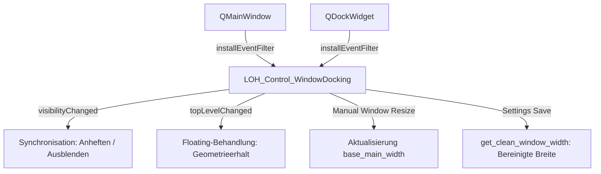

# Dokumentation: LOH_Control_WindowDocking

Diese Dokumentation beschreibt die universelle Fenster-Docking-Steuerung [Structure/LOH_Control_WindowDocking.py](file:///d:/Starfield_LOH/Structure/LOH_Control_WindowDocking.py) im Projekt **Starfield Load Order Helper (LOH)**.

---

## 1. Zweck & Motivation

### 1.1 Technische Problemstellung im nativen Qt
Qt's Standard-Docking-System (`QDockWidget` in `QMainWindow`) führt bei komplexen Applikationen häufig zu unerwünschten Geometrieeffekten:
* **Unerwünschte Schrumpfung beim Abdocken:** Wird ein angedocktes Fenster in den Schwebestatus (Floating) überführt, verkleinert Qt das Hauptfenster oft abrupt oder belässt es in verzerrten Proportionen.
* **Verfälschte Einstellungs-Speicherung:** Speichert die Anwendung `window.width()` ab, während ein 600–1000 px breites Dockfenster angedockt ist, startet die App beim nächsten Mal mit einer überdimensionierten Gesamtbreite.
* **Flackern beim Schließen:** Das synchrone Schließen von Dockfenstern erzeugt ohne Kapselung sichtbare Bildstörungen und verzögertes Layout-Reflow.

### 1.2 Die Lösung: `LOH_Control_WindowDocking`
`LOH_Control_WindowDocking` (vormals `LOH_DockManager`) entkoppelt die Basisgeometrie des Hauptfensters von der temporären Dockbreite:
1. **Dynamische Basisbreiten-Führung (`base_main_width`):** Manuelle Breitenänderungen des Hauptfensters durch den Anwender werden kontinuierlich erfasst:  
   $$\text{base\_main\_width} = \max(1280, \text{main\_window.width()} - (\text{dock\_width} + \text{SEPARATOR\_WIDTH}))$$
2. **Reiner Qt-Standard beim Abdocken (Floating):** Beim Herauslösen in ein schwebendes Fenster bleibt die Hauptfensterbreite unverändert stabil.
3. **Flackerfreies Schließen:** Dock-Schließen erfolgt unter Kapselung von `main_window.setUpdatesEnabled(False)` und Vorab-Aktivierung des Layouts (`main_window.layout().activate()`).
4. **Persistente Einstellungs-Sauberkeit (`get_clean_window_width()`):** Garantiert, dass in den Benutzer-Einstellungen stets die bereinigte Hauptfensterbreite ohne angedockte Zusatzbreite hinterlegt wird.

---

## 2. Architektur & Event-Handling



* **Event-Filter-Architektur:** Installiert Event-Filter auf `main_window` und `dock_widget`, um `Resize`-, `Move`- und `Show`-Events in Echtzeit abzufangen.
* **Abwärtskompatibilität:** Die Klasse stellt die Aliase `LOH_Control_DockManager` und `LOH_DockManager` bereit.

---

## 3. API-Referenz

### 3.1 Konstruktor
```python
LOH_Control_WindowDocking(main_window: QMainWindow, dock_widget: QDockWidget)
```

| Parameter | Typ | Beschreibung |
| :--- | :--- | :--- |
| `main_window` | `QMainWindow` | Das Hauptfenster der Anwendung. |
| `dock_widget` | `QDockWidget` | Das zu verwaltende Dock-Widget (z. B. `Window_Mod_Statistics`). |

---

### 3.2 Methoden
* **`toggle()`:**  
  Schaltet die Sichtbarkeit des Dock-Widgets um (öffnet oder schließt es flackerfrei).
* **`show()`:**  
  Öffnet das Dockfenster und erweitert das Hauptfenster um die Dockbreite + Trennlinie.
* **`hide()`:**  
  Schließt das Dockfenster und stellt die ursprüngliche Basisbreite wieder her.
* **`get_clean_window_width() -> int`:**  
  Liefert die bereinigte Basisbreite für die persistenten Einstellungen (`settings['window']['width']`), unabhängig davon, ob das Dock aktuell geöffnet oder angedockt ist.

---

## 4. Anwendungsbeispiel

```python
from Structure.Pages.Window_Mod_Statistics import Window_Mod_Statistics
from Structure.LOH_Control_WindowDocking import LOH_Control_WindowDocking

# 1. Dock-Fenster initialisieren und anheften
self.dock_statistics = Window_Mod_Statistics(self)
self.addDockWidget(Qt.DockWidgetArea.RightDockWidgetArea, self.dock_statistics)
self.dock_statistics.setVisible(False)

# 2. Docking-Steuerung verbinden
self.dock_manager = LOH_Control_WindowDocking(self, self.dock_statistics)

# 3. Umschaltung per Schaltfläche oder Signal
self.btn_toggle_stats.clicked.connect(self.dock_manager.toggle)

# 4. Sauberes Schließen und Speichern in closeEvent
def closeEvent(self, event):
    self.settings["window"]["width"] = self.dock_manager.get_clean_window_width()
    self.settings["window"]["height"] = self.height()
    super().closeEvent(event)
```

---

## 5. Konformität mit Design-Rules

`LOH_Control_WindowDocking` setzt alle Vorgaben aus [Design_Rules.md](file:///d:/Starfield_LOH/Documentation/Design_Rules.md) (Abschnitt 5) um:
* Basisbreiten-Führung bei manuellem Resize
* Flackerfreies, atomares Schließen
* Persistente Speicherung via `get_clean_window_width()`.
