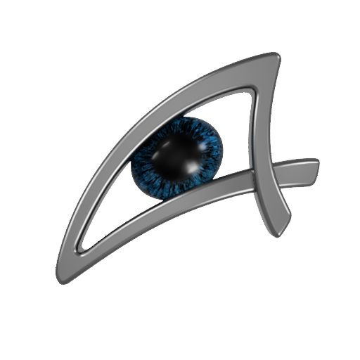

<p align="center">
  
</p>

<h1 align="center">Starfield Load Order Helper (LOH)</h1>

<p align="center">
  <a href="https://www.python.org/"></a>
  <a href="https://wiki.qt.io/Qt_for_Python"></a>
  <a href="LICENSE"></a>
  
</p>

---

Der **Starfield Load Order Helper (LOH)** ist ein spezialisierter Mod-Manager und Analyse-Assistent für das Rollenspiel Starfield. Die Anwendung arbeitet nicht mit rein statischen Wissensdatenbanken, sondern untersucht installierte Mod-Dateien direkt auf Binärebene. Unterstützend werden automatisiert Informationen vom Bethesda Creation Store und von Nexus Mods bezogen.

Damit erkennt der Starfield LOH Daten- und Modkonflikte und unterstützt den Spieler bei der automatisierten Kategorisierung und der Erstellung einer stabilen Ladereihenfolge nach den Anforderungen der Creation Engine 2. Das Programm bietet eine profilbasierte Mod-Verwaltung und kann auf Spielstände abgestimmte Ladereihenfolgen (`Plugins.txt`) aktivieren.

---

## Hauptfunktionen

- **Automatisierte Metadaten-Anbindung (`Bethesda_Fetch.py`, `Nexus_Fetch_API.py`, `LOOT_Fetch.py`):** High-Speed REST- und GraphQL-gestütztes Auslesen von Bethesda Creation Store und Nexus Mods Daten sowie Abgleich gegen die offizielle Starfield LOOT-Masterlist mit sicherem DPAPI-Schlüsselschutz.
- **Automatisierte Mod-Klassifizierung (`Category_LOH_Classifier.py`):** Logische Erkennung und Zuordnung von Mods in das LLO-Kategoriensystem (Logical Load Order, Positionen 1 bis 32) anhand von internen Datenstrukturen, Keyword-Signaturen und Store-Metadaten.
- **Umfassende Konflikt-Analyse (`Mods_Conflicts_Analyzer.py`):** Tiefgehende Untersuchung von Überschreibungen auf Record- und FormID-Ebene, Cell- und Worldspace-Kollisionen sowie Asset-Konflikten zur frühzeitigen Erkennung von Instabilitäten.
- **Intelligente 4-Stufen-Sortier-Pipeline (`LoadOrder_Sorter.py`):**
  1. Stufe 1 (Kategorie-Vorsortierung): Grobe Gruppierung aller installierten Mods anhand der LLO-Hauptkategorien (Positionen 1 bis 32) aus dem Classifier.
  2. Stufe 2 (Strukturierte Einordnung innerhalb einer Kategorie): Feinsortierung und Binnengruppen-Gravitation unter Berücksichtigung von Touchpoint-Ausschlüssen und Unterkategorien.
  3. Stufe 3 (Beachten von Abhängigkeiten und Konfliktvermeidung): Auflösen von Mod-Voraussetzungen, Masterfile-Abhängigkeiten sowie intelligente Konfliktauflösung bei Überschreibungen (Delete-vs-Disable, gezielte Overrides).
  4. Stufe 4 (Profil-Validierung & Export): Ausgabe einer konsistenten, optimierten Ladereihenfolge direkt in die aktive `Plugins.txt`.
- **Begleitete Mod-Update-Pipeline mit automatischem Backup & Rollback (`Starfield_Mod_Update.py`, `Window_Mod_Update_Overlay.py`):** Strukturierter Prozess zur Aktualisierung von Creations-Mods mit automatischer Erkennung neuerer Versionen:
  1. *Sichere Vorbereitung:* Saubere Austragung und isoliertes Backup betroffener Mod-Dateien vor Spielstart.
  2. *Begleitendes Desktop-HUD & Live-Scanner:* Rahmenloses Echtzeit-Overlay während des Spiels mit 500ms-Hintergrund-Scanner zur Erkennung abgeschlossener Downloads (`ContentCatalog.txt`) und Aktivierungen (`Plugins.txt`).
  3. *Automatisches Rollback-System:* Lückenlose Wiederherstellung des Ausgangszustands bei vorzeitigem Abbruch oder Fehlschlag des Update-Laufs.
- **Profil-Verwaltung mit automatischen Backups (`Starfield_Profile_Activation.py`, `LOH_Backup_Manager.py`):** Sicheres Speichern, Wechseln und Aktivieren unterschiedlicher Mod-Zusammenstellungen inklusive automatisierter Backups im Verzeichnis `Data/Backups/`.

---

## Entwicklung & KI-Unterstützung

<table>
  <tr>
    <td width="130" align="center" valign="middle">
      
    </td>
    <td>
      <strong>Entwickelt von Looking4</strong><br>
      Der Starfield Load Order Helper (LOH) wurde von <strong>Looking4</strong> konzipiert und entwickelt. Die Systemarchitektur, das relationale Datenbankschema, die Algorithmen zur Konfliktbewertung und die Programmlogik beruhen vollständig auf dem Entwurf des Architekten. Sämtliche grafischen Elemente und Benutzeroberflächen-Icons wurden per Hand selbst erstellt.
    </td>
  </tr>
  <tr>
    <td width="130" align="center" valign="middle">
      
    </td>
    <td>
      <strong>KI-Unterstützung & Methodik</strong><br>
      Die Anwendung entstand mit der Unterstützung moderner künstlicher Intelligenz. Zum Einsatz kam die <strong>Google Antigravity IDE</strong> mit eingebundenen Gemini-Agenten. Die KI wurde maßgeblich für die Datenanalyse der Mod-Dateien (binäres Parsing von Creation Engine 2 Strukturen) und die Codierungsunterstützung genutzt. Zusätzlich wurde sie für die vergleichende Synthese von Informationsquellen (wie LLO oder LOOT) herangezogen – stets unter striktem Abgleich mit den Quelldokumenten und menschlicher Validierung.
    </td>
  </tr>
</table>

---

## Systemanforderungen

- **Betriebssystem:** Windows 10 oder Windows 11 (64-Bit)
- **Python:** Version 3.12 oder neuer *(nur bei Ausführung aus dem Quellcode erforderlich; die portable Release-Version ist autark)*
- **Spiel:** Starfield (Steam-Installation mit gültigem Spieleverzeichnis)

---

## Schnellstart & Installation

### Option A: Portable Version (Empfohlen für Anwender)
Die portable Version ist vollständig autark vorkompiliert und benötigt **weder eine Python-Installation noch externe Laufzeitbibliotheken oder Browser-Treiber**:

1. Lade das neueste Release-Archiv (`Starfield_LOH_vX.X.X_Portable.zip`) unter [Releases](https://github.com/Looking4Git/Starfield_LOH/releases) herunter.
2. Entpacke das ZIP-Archiv in ein beliebiges lokales Verzeichnis (z. B. `D:\Starfield_LOH\`).
3. Starte `Starfield_LOH.exe`.


### Option B: Ausführung aus dem Quellcode (Für Entwickler)

#### 1. Repository klonen
```bash
git clone https://github.com/Looking4Git/Starfield_LOH.git
cd Starfield_LOH
```

#### 2. Abhängigkeiten installieren
```bash
pip install -r requirements.txt
```

#### 3. Anwendung starten
```bash
python Starfield_LOH.pyw
```
Beim ersten Start initialisiert sich die Arbeitsdatenbank (`Database/Starfield_LOH.db`) sowie die Konfigurationsdatei (`Starfield_LOH_Settings.json`) automatisch aus den mitgelieferten Vorlagen.

---

## Lizenz & Rechtliche Hinweise

Dieses Projekt ist unter der **[MIT-Lizenz](LICENSE)** lizenziert.

### Markenrechtlicher Disclaimer & Drittanbieter
- **Starfield™** ist ein eingetragenes Warenzeichen von Bethesda Softworks LLC / ZeniMax Media Inc.
- **Nexus Mods™** ist ein eingetragenes Warenzeichen von Black Tree Gaming Ltd.
- **LOOT (Load Order Optimisation Tool):** Verwendet die offizielle Starfield Masterlist, lizenziert unter [Creative Commons Zero (CC0 1.0)](https://github.com/loot/starfield).
- **Bethesda Creations & Webdaten:** Der Abruf öffentlich zugänglicher Metadaten erfolgt automatisiert über die REST- und GraphQL-Schnittstellen zur persönlichen Konfiguration der installierten Mods. Dieses Tool steht in keiner Verbindung zu Bethesda Softworks und wird nicht von Bethesda autorisiert.
- Der Starfield Load Order Helper ist ein inoffizielles Community-Projekt und steht in keiner geschäftlichen Verbindung zu Bethesda Softworks, ZeniMax Media oder Black Tree Gaming Ltd.
- Entwickelt mit Python und PySide6 (Qt für Python, lizenziert unter der LGPLv3).
- Detaillierte Lizenz- und Urheberrechtsangaben aller verwendeten Komponenten sind in der Datei **[NOTICE](NOTICE)** hinterlegt.

---

## Echtheitsprüfung & Signatur

Offizielle Release-Binärdateien (`Starfield_LOH.exe`) werden digital mit Microsoft Authenticode signiert. Zur Überprüfung der Integrität und Echtheit kann der kryptografische Fingerabdruck (SHA-1 Thumbprint) in den Windows-Dateieigenschaften (*Rechtsklick auf die Datei &rarr; Eigenschaften &rarr; Digitale Signaturen &rarr; Details*) mit dem offiziellen Schlüssel abgeglichen werden:

<div align="center">
  <br>
  <div style="display: inline-block; background-color: #FFFFFF; padding: 12px 28px; border-radius: 6px; border: 1px solid #D0D7DE;">
    <span style="color: #111111; font-family: Consolas, 'Courier New', monospace; font-size: 16px; font-weight: bold; letter-spacing: 2px;">
      1C70DCFE3AA3A3E645AF5D39B0240BEF16A0A413
    </span>
  </div>
  <p align="center">
    <sub><strong>Offizieller Looking4 Authenticode-Fingerabdruck (SHA-1 Thumbprint)</strong></sub>
  </p>
  <br>
</div>
