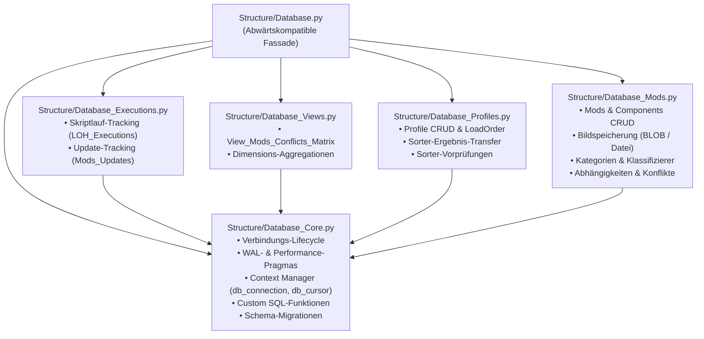

# Fachdokumentation: Datenbank-Subsystem (`Structure/Database*.py`)
Stand: 27.09.2026

---

## 1. Überblick & Zielsetzung

Das Datenbank-Subsystem von Starfield Load Order Helper (LOH) kapselt den gesamten Datenzugriff auf die zentrale SQLite-Anwendungsdatenbank (`Database/Starfield_LOH.db`). Es verwaltet Mod-Stammdaten, binär geparste ESM-Komponenten, berechnete Ladereihenfolgen, Laufzeit-Protokollierungen und relationale Views.

Zur Erhöhung der Wartbarkeit und zur Vermeidung monolithischer Strukturen wurde die Datenbank-Schicht im Rahmen des Refactorings (Q-03 & Q-04) in eine modulare, flache Komponentenstruktur aufgeteilt. Die zentrale Datei [Structure/Database.py](file:///d:/Starfield_LOH/Structure/Database.py) fungiert dabei als abwärtskompatible Fassade, die sämtliche Funktionen und Konstanten nach außen re-exportiert.

---

## 2. Modul-Architektur & Zuständigkeiten

Die Datenbanklogik ist in fünf fachspezifische Teilmodule unter `Structure/` gegliedert:



### 2.1 [Database_Core.py](file:///d:/Starfield_LOH/Structure/Database_Core.py)
Verantwortlich für grundlegende Datenbank-Infrastruktur:
* **Verbindungsaufbau (`get_db_connection`):** Öffnet SQLite-Verbindungen mit `sqlite3.Row`-Factory, aktiviert Foreign Keys (`PRAGMA foreign_keys = ON`) und registriert die benutzerdefinierte SQL-Funktion `version_is_newer`.
* **Transaktionale Context Manager:** [`db_connection(auto_commit)`](file:///d:/Starfield_LOH/Structure/Database_Core.py#L112) und [`db_cursor(auto_commit)`](file:///d:/Starfield_LOH/Structure/Database_Core.py#L143) zur automatischen Transaktionssteuerung und garantierten Ressourcenfreigabe.
* **Pragmas & Performance:** [`ensure_default_database_mode`](file:///d:/Starfield_LOH/Structure/Database_Core.py#L157) (Standard: `WAL`, `synchronous = NORMAL`, `busy_timeout = 60000`), [`enable_db_performance_mode`](file:///d:/Starfield_LOH/Structure/Database_Core.py#L268) (während Massen-Parsing: `synchronous = OFF`, `cache_size = -64000`) und [`restore_db_default_mode`](file:///d:/Starfield_LOH/Structure/Database_Core.py#L290).
* **Schema-Integrität:** Automatische Schemaprüfungen (`ensure_mods_updates_schema`, `ensure_mods_category_loot_schema`, `ensure_conflict_solution_types_schema`, `init_sorter_results_table`, `init_loh_executions_table`).

### 2.2 [Database_Executions.py](file:///d:/Starfield_LOH/Structure/Database_Executions.py)
Verwaltung von Skriptausführungen und Live-Status:
* **`LOH_Executions`:** Protokollierung von Start (`record_script_start`), regulärem Ende (`record_script_end`), Abbruch (`record_script_abort`) und Statusaktualisierungen (`update_script_execution_state`, `get_script_last_execution`).
* **`Mods_Updates`:** Verwaltung des Status offener Mod-Updates im Rahmen von `Starfield_Mod_Update.py` (`init_mods_updates`, `set_mod_update_state`, `get_incomplete_mods_updates`, `apply_completed_mod_updates`).

### 2.3 [Database_Views.py](file:///d:/Starfield_LOH/Structure/Database_Views.py)
Erstellung und Auswertung relationaler Views:
* **`View_Mods_Conflicts_Matrix`:** Erstellt und aktualisiert den relationalen View zur paarweisen Kollisionszählung (`Mod_ID_A < Mod_ID_B`) gruppiert nach CE2-Signaturkategorien.
* **`get_mod_conflicts_matrix`:** Abfrage der Matrixdaten für das Frontend.
* **`create_view_category_dimension_max`:** Berechnet Maximaldimensionen der LOH-Kategorien.

### 2.4 [Database_Profiles.py](file:///d:/Starfield_LOH/Structure/Database_Profiles.py)
Profile und Ladereihenfolgen:
* **Profilverwaltung:** [`get_profiles`](file:///d:/Starfield_LOH/Structure/Database_Profiles.py#L28), [`create_profile`](file:///d:/Starfield_LOH/Structure/Database_Profiles.py#L125), [`copy_profile`](file:///d:/Starfield_LOH/Structure/Database_Profiles.py#L142), [`delete_profile`](file:///d:/Starfield_LOH/Structure/Database_Profiles.py#L172), [`update_profile_description`](file:///d:/Starfield_LOH/Structure/Database_Profiles.py#L196).
* **LoadOrder-Operationen:** [`get_load_order`](file:///d:/Starfield_LOH/Structure/Database_Profiles.py#L42), [`update_load_order_active`](file:///d:/Starfield_LOH/Structure/Database_Profiles.py#L104), atomare Positionsaktualisierung [`update_load_order_positions`](file:///d:/Starfield_LOH/Structure/Database_Profiles.py#L213) mit 2-Phasen-Verfahren zur Vermeidung von `UNIQUE`-Verletzungen.
* **Sorter-Ergebnisse:** [`apply_sorter_to_profile`](file:///d:/Starfield_LOH/Structure/Database_Profiles.py#L252), [`apply_sorter_to_all_profiles`](file:///d:/Starfield_LOH/Structure/Database_Profiles.py#L323) und [`check_sorter_prerequisites`](file:///d:/Starfield_LOH/Structure/Database_Profiles.py#L400).

### 2.5 [Database_Mods.py](file:///d:/Starfield_LOH/Structure/Database_Mods.py)
Mod-Katalog, Komponenten und Metadaten:
* **Mod-Abfragen:** [`get_mods_by_state`](file:///d:/Starfield_LOH/Structure/Database_Mods.py#L41), [`get_mods_with_updates`](file:///d:/Starfield_LOH/Structure/Database_Mods.py#L74), [`get_mod_by_id`](file:///d:/Starfield_LOH/Structure/Database_Mods.py#L233), [`update_mod_details`](file:///d:/Starfield_LOH/Structure/Database_Mods.py#L198).
* **Komponenten & Masterfiles:** [`check_component_exists`](file:///d:/Starfield_LOH/Structure/Database_Mods.py#L219), [`get_components_by_mod_id`](file:///d:/Starfield_LOH/Structure/Database_Mods.py#L248), [`get_masterfiles_by_mod_id`](file:///d:/Starfield_LOH/Structure/Database_Mods.py#L265), [`ensure_component_registered`](file:///d:/Starfield_LOH/Structure/Database_Mods.py#L400).
* **Lookups & Statistik:** [`get_lookup_data`](file:///d:/Starfield_LOH/Structure/Database_Mods.py#L169), [`get_mod_category_stats`](file:///d:/Starfield_LOH/Structure/Database_Mods.py#L457), [`apply_all_classifier_categories`](file:///d:/Starfield_LOH/Structure/Database_Mods.py#L508).
* **Bildverwaltung:** [`get_mod_image`](file:///d:/Starfield_LOH/Structure/Database_Mods.py#L131) und [`save_mod_image_file`](file:///d:/Starfield_LOH/Structure/Database_Mods.py#L150).
* **UI-Vorbereitung:** Anforderungen ([`get_mod_requirements_for_ui`](file:///d:/Starfield_LOH/Structure/Database_Mods.py#L309)), Abhängigkeiten ([`get_mod_dependencies_for_ui`](file:///d:/Starfield_LOH/Structure/Database_Mods.py#L328)) und Konflikte mit Worst-Case-Farbeinstufung ([`get_mod_conflicts_for_ui`](file:///d:/Starfield_LOH/Structure/Database_Mods.py#L349)).

### 2.6 [Database.py](file:///d:/Starfield_LOH/Structure/Database.py) (Fassade)
Re-exportiert alle Symbole der fünf Module über `from Structure.Database_* import ...` und deklariert ein lückenloses `__all__`-Tupel. Für externe Aufrufer bleibt die Schnittstelle `from Structure.Database import ...` vollständig unverändert.

---

## 3. Transaktionales Context-Manager-System

Zur Vermeidung offener Datenbank-Handles und zur Sicherstellung von Transaktionsintegrität bei Fehlern stehen zwei Context-Manager zur Verfügung:

### 3.1 `db_connection(auto_commit: bool = True)`
Verwaltet den Verbindungslebenszyklus:
```python
from Structure.Database import db_connection

with db_connection(auto_commit=True) as conn:
    cursor = conn.cursor()
    cursor.execute("UPDATE Mods SET Note = ? WHERE ID = ?", ("Notiz", 12))
    # Automatischer Commit bei regulärem Verlassen des Blocks.
    # Bei einer Exception erfolgt automatisches Rollback und Schließen der Verbindung.
```

### 3.2 `db_cursor(auto_commit: bool = True)`
Erzeugt direkt einen aktiven Cursor auf einer abgesicherten Verbindung:
```python
from Structure.Database import db_cursor

# Für lesende Operationen (kein Commit erforderlich):
with db_cursor(auto_commit=False) as cursor:
    cursor.execute("SELECT ID, Name FROM Platforms")
    rows = cursor.fetchall()

# Für schreibende Operationen:
with db_cursor(auto_commit=True) as cursor:
    cursor.execute("DELETE FROM LoadOrder WHERE ID_Profile = ?", (profile_id,))
```

---

## 4. Richtlinien für Entwickler

1. **Keine manuellen `sqlite3.connect()`-Aufrufe:**  
   Im gesamten Projekt ist ausschließlich `get_db_connection()`, `db_connection()` oder `db_cursor()` zu verwenden, um WAL-Pragmas, Timeout-Regeln und Foreign-Key-Prüfungen zu garantieren.
2. **Import-Konventionen:**  
   Bestehende Module können weiterhin `from Structure.Database import ...` nutzen. Neu entwickelter Code kann bei Bedarf direkt auf die fachspezifischen Submodule zugreifen (z. B. `from Structure.Database_Profiles import get_profiles`).
3. **Schutz der `version.json`:**  
   Die Datei `version.json` wird ausschließlich durch das Build-Tool des Architekten (`Tools/Build_Release.py`) verwaltet und darf niemals durch Datenbankoperationen berührt werden.
