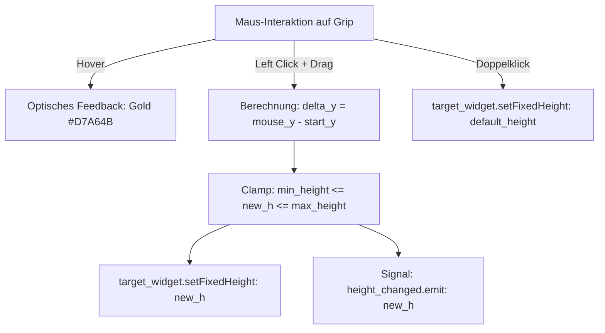

# Dokumentation: LOH_Control_SectionResizeGrip

Diese Dokumentation beschreibt die universelle Sci-Fi-Ziehgriff-Steuerung [Structure/LOH_Control_SectionResizeGrip.py](file:///d:/Starfield_LOH/Structure/LOH_Control_SectionResizeGrip.py) im Projekt **Starfield Load Order Helper (LOH)**.

---

## 1. Zweck & Motivation

### 1.1 Technische Problemstellung
In datenintensiven Detail- und Analysemasken (wie dem Statistik-Fenster [Window_Mod_Statistics.py](file:///d:/Starfield_LOH/Structure/Pages/Window_Mod_Statistics.py)) variiert der Platzbedarf einzelner Inhaltsbereiche stark:
* **Feste Höhen sind unflexibel:** Eine fixe Höhe von 400 px ist für komplexe Spinnennetz-Diagramme mit 32 Achsen zu gedrängt, während ein Balkendiagramm mit 32 Zeilen darin vertikal scrollen muss.
* **Manuelle Anpassbarkeit gefordert:** Der Anwender benötigt die Möglichkeit, die Höhe von Sektionen bedarfsgerecht per Maus stufenlos zu vergrößern oder zu verkleinern, ohne die übergeordnete ScrollArea-Architektur zu stören.

### 1.2 Die Lösung: `LOH_Control_SectionResizeGrip`
`LOH_Control_SectionResizeGrip` ist eine eigenständige, wiederverwendbare Griffleiste, die am unteren Rand beliebiger Sektionen platziert werden kann:
1. **Stufenlose Höhenführung:** Per Mausdrag (`SizeVerCursor`) zieht der Anwender die Sektion flüssig größer oder kleiner.
2. **Begrenzungsschutz (`min_height` & `max_height`):** Verhindert das unkontrollierte Kollabieren oder übermäßige Aufblähen des Bereichs.
3. **Doppelklick-Reset:** Ein Doppelklick auf die Griffleiste setzt die Höhe sofort auf die definierte Standardhöhe (`default_height`) zurück.
4. **Dezentes Sci-Fi-Design:** Schlanke 12px-Höhe mit Starfield-blauen Trennlinien und fünf zentrierten Grip-Punkten, die bei Mouse-Over in Starfield-Gold (`#D7A64B`) aufleuchten.
5. **Auto-Fit-Unterstützung:** Erlaubt der umschließenden Sektion, bei Moduswechseln (z. B. Spinnennetz $\leftrightarrow$ Balkendiagramm) die Standard- und Mindesthöhen dynamisch anzupassen.

---

## 2. Architektur & Interaktionsfluss



* **Kein Layout-Konflikt:** Die Komponente manipuliert direkt die `setFixedHeight`-Eigenschaft des Ziel-Widgets (`target_widget`). Das übergeordnete Layout (z. B. in `CollapsibleSection` oder `QScrollArea`) passt sich dank Standard-Qt-Größenregeln automatisch flackerfrei an.

---

## 3. API-Referenz

### 3.1 Konstruktor
```python
LOH_Control_SectionResizeGrip(
    target_widget: QWidget,
    min_height: int = 380,
    max_height: int = 1000,
    default_height: int = 480,
    parent: QWidget = None
)
```

| Parameter | Typ | Standard | Beschreibung |
| :--- | :--- | :--- | :--- |
| `target_widget` | `QWidget` | *Pflicht* | Das zu skalierende Sektions-Widget. |
| `min_height` | `int` | `380` | Untere Grenze in Pixeln (kann durch Ziehen nicht unterschritten werden). |
| `max_height` | `int` | `1000` | Obere Grenze in Pixeln. |
| `default_height`| `int` | `480` | Initiale Standardhöhe und Zielhöhe bei Doppelklick-Reset. |
| `parent` | `QWidget`| `None` | Optionales Eltern-Widget (standardmäßig `target_widget`). |

---

### 3.2 Methoden
* **`set_default_height(h: int)`:**  
  Aktualisiert die Standard-Zielhöhe für den Doppelklick-Reset (z. B. bei Umschaltung von Radar 480 px auf Balken 680 px).
* **`set_min_height(h: int)`:**  
  Aktualisiert die minimale Ziehhöhe.
* **`set_max_height(h: int)`:**  
  Aktualisiert die maximale Ziehhöhe.

### 3.3 Signale
* **`height_changed = Signal(int)`:**  
  Wird kontinuierlich beim Ändern der Höhe emittiert und übergibt die neue Höhe in Pixeln.

---

## 4. Anwendungsbeispiel

```python
from Structure.LOH_Control_SectionResizeGrip import LOH_Control_SectionResizeGrip

class MyContentSection(QWidget):
    def __init__(self, parent=None):
        super().__init__(parent)
        self.default_radar_height = 480
        self.default_bar_height = 680
        self.setFixedHeight(self.default_radar_height)

        layout = QVBoxLayout(self)
        # ... Komponenten hinzufügen ...

        # ResizeGrip am unteren Ende des Layouts einbetten
        self.resize_grip = LOH_Control_SectionResizeGrip(
            target_widget=self,
            min_height=380,
            max_height=1000,
            default_height=self.default_radar_height,
            parent=self
        )
        layout.addWidget(self.resize_grip)

    def on_view_toggled(self, is_bar: bool):
        target_h = self.default_bar_height if is_bar else self.default_radar_height
        self.resize_grip.set_default_height(target_h)
        self.resize_grip.set_min_height(500 if is_bar else 380)
        self.setFixedHeight(target_h)
```

---

## 5. Konformität mit Design-Rules

`LOH_Control_SectionResizeGrip` erfüllt die Vorgaben aus [Structure/Design_Rules.md](file:///d:/Starfield_LOH/Structure/Design_Rules.md) (Abschnitt 2.J):
* Diskrete Sci-Fi-Ziehmarkierung ohne aufdringliche Rahmen
* Hover-Farbe Starfield-Gold (`#D7A64B`), Ruhezustand Starfield-Blau (`#304C7A`)
* Cursor `Qt.CursorShape.SizeVerCursor` für intuitive Bedienbarkeit.
