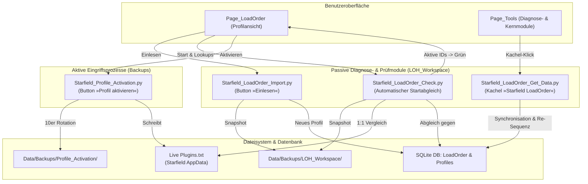

# Dokumentation: Starfield LoadOrder Modul-Architektur

> **Status:** Verbindlich implementiert (Phase B)  
> **Projekt:** Starfield Load Order Helper (LOH)  
> **Referenz:** [ai-manifest.md](file:///d:/Starfield_LOH/ai-manifest.md), [LOH_Backup_Architecture_Documentation.md](file:///d:/Starfield_LOH/Structure/LOH_Backup_Architecture_Documentation.md)

---

## 1. Übersicht & Funktionale Rollenverteilung

Das Management der Ladereihenfolge (`Plugins.txt` und Datenbanktabelle `LoadOrder`) stützt sich auf vier strikt abgegrenzte Module mit klar definierten Verantwortlichkeiten:

---

## 2. Modul-Spezifikationen im Detail

### 2.1 `Starfield_LoadOrder_Import.py` (Fokussierter Profil-Import)
* **Aufruf:** Ausschließlich interaktiv über die Schaltfläche **»Einlesen«** auf [Page_LoadOrder.py](file:///d:/Starfield_LOH/Structure/Pages/Page_LoadOrder.py).
* **Zweck:** Liest eine bestehende `Plugins.txt` ein, validiert fehlende Komponenten gegen die Mod-Datenbank und legt ein **neues, separates Profil** (mit vom Benutzer frei wählbarem Profilnamen und optionaler Beschreibung via [Dialog_Profil.py](file:///d:/Starfield_LOH/Structure/Pages/Dialog_Profil.py)) in der Datenbank an.
* **Sicherungskategorie:** Passiv (Snapshot).
* **Sicherungsort:** `Data/Backups/LOH_Workspace/Starfield_LoadOrder_Import/Plugins.txt`.

---

### 2.2 `Starfield_LoadOrder_Get_Data.py` (Globale Profil-Synchronisation)
* **Aufruf:** Über die Modul-Kachel **»Starfield LoadOrder«** auf [Page_Tools.py](file:///d:/Starfield_LOH/Structure/Pages/Page_Tools.py).
* **Zweck:** Führt eine globale Wartung und Bereinigung **aller bestehenden Profile** in der Datenbank durch:
  1. **Bereinigung:** Entfernt Komponenten aus der Tabelle `LoadOrder`, deren zugehörige Mods gelöscht oder deaktiviert wurden (`State != 1`).
  2. **Re-Sequenzierung:** Schließt Positionslücken und nummeriert alle Komponenten eines Profils lückenlos von `1` bis `N` durch.
  3. **Neu-Erfassung:** Hängt neu gefundene, installierte Komponenten automatisch am Ende der Profile an (Aktivierungsstatus `*` aus `Plugins.txt` wird übernommen).
  4. **Notfall-Initialisierung:** Legt nur dann ein Standard-Profil an, falls 0 Profile in der Datenbank existieren.
* **Sicherungskategorie:** Passiv (Snapshot).
* **Sicherungsort:** `Data/Backups/LOH_Workspace/Starfield_LoadOrder_Get_Data/Plugins.txt`.
* **Protokollierung:** `Logs/Starfield_LOH_LoadOrder_Get_Data.log`.

---

### 2.3 `Starfield_LoadOrder_Check.py` (Reine Start- und Prüfroutine)
* **Aufruf:** Automatisch beim Start von Starfield LOH bzw. beim Aufbau der Profilliste in `Page_LoadOrder.load_lookups()`.
* **Zweck:** Reine **Verifikations- und Erkennungsroutine** ohne verändernden Datenbank-Eingriff:
  1. **Snapshot:** Sichert die aktuell im Spiel befindliche `Plugins.txt` nach `Data/Backups/LOH_Workspace/Starfield_LoadOrder_Check/Plugins.txt`.
  2. **Sequenz-Parsing:** Liest die Reihenfolge und den Aktivierungsstatus aller Komponenten aus `Plugins.txt` ein.
  3. **1:1-Abgleich:** Vergleicht die Sequenz gegen jedes Profil in der Tabelle `LoadOrder` (`get_load_order(profile_id)`).
  4. **Visuelle Signalgebung:** Gibt alle übereinstimmenden Profil-IDs zurück.
* **UI-Darstellung:**
  * Das bzw. die übereinstimmenden Profile werden im Profil-Baum (`tree_profile`) auffällig in **Deep Sci-Fi Grün (`#1F7343`)** mit **weißem Text (`#FFFFFF`)** hinterlegt.
  * Tooltip: `Aktives Profil (stimmt mit Plugins.txt überein)`.
  * Keine Übereinstimmung $\to$ alle Zeilen bleiben neutral im Standard-Design `#ECECEC`.
* **Protokollierung:** `Logs/Starfield_LOH_LoadOrder_Check.log`.

---

### 2.4 `Starfield_Profile_Activation.py` (Aktive Profil-Bereitstellung)
* **Aufruf:** Über die Schaltfläche **»Profil aktivieren«** auf [Page_LoadOrder.py](file:///d:/Starfield_LOH/Structure/Pages/Page_LoadOrder.py).
* **Zweck:** Schreibt die Ladereihenfolge des selektierten Profils physisch in die `Plugins.txt` des Starfield-Spieleverzeichnisses:
  * Aktive Komponenten (`Is_Active = 1`): mit führendem Asterisk (`*Mod.esm`).
  * Inaktive Komponenten (`Is_Active = 0`): ohne Asterisk (`Mod.esm`).
* **Sicherungskategorie:** Aktiv (10er-Rotation mit Zeitstempeln).
* **Sicherungsort:** `Data/Backups/Profile_Activation/<JJJJ.MM.TT_HH.MM.SS>/` (`Plugins_Original.txt` vor dem Eingriff, `Plugins_New.txt` nach dem Eingriff).
* **Signalfluss:** Nach erfolgreicher Bereitstellung aktualisiert `Page_LoadOrder.refresh_profile_highlights()` sofort die grüne Zeilenmarkierung für das neu aktivierte Profil.
